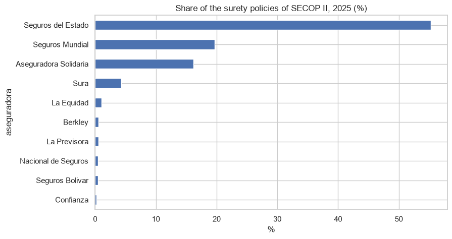
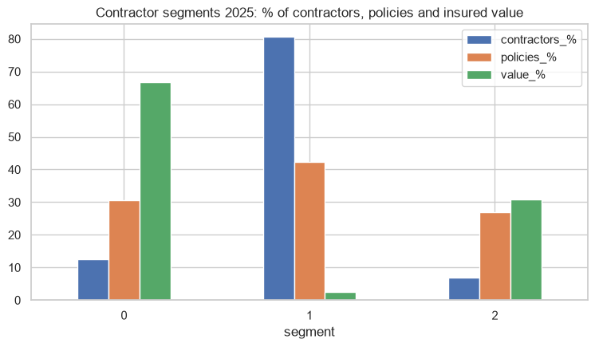

# Surety market of public procurement in Colombia

Every contractor of the State buys guarantees (pólizas de cumplimiento) and SECOP II publishes them. I made this project for Cuántico Agencia de Seguros: which insurers compete in this market and how, and which groups of contractors exist.

## Data
SECOP II - Garantías (7.1 million records) and the solvency report of the Superintendencia Financiera (datos.gov.co). The tables with contractor names stay private and are not in the repository.

## What I did
- Cleaning of the insurer names: the field is free text with 26.313 different spellings, I map them to the real companies with rules (98.4% identified)
- Market shares and HHI 2019-2026
- K-means of the insurers and of the 276.435 contractors of 2025

## Main results
- Seguros del Estado has 55% of the policies, Mundial 20% and Solidaria 16% (top 3 = 91%).
- Two big types of insurers: mass-market (small average values) and specialists in big risks (average values of thousands of millions, more rejections).
- 3 segments of contractors: key accounts (12% of contractors, 67% of the value, loyal to one insurer), multi-insurer contractors (7%, 31% of the value, the best target for a broker) and individuals (81% of contractors, 3% of the value).




## How to run

```
pip install -r requirements.txt
jupyter notebook surety_market_clustering.ipynb
```

---
Alejandro Lezcano Osorio | Universidad EIA (Colombia) and Rennes School of Business (France)
